  
  
  

  

## 👋 About me

I'm a **full-stack developer from Algeria 🇩🇿** with **8+ years** of building web applications that businesses run on every day.
I design the database, write the backend in **Laravel**, build the interface in **React** or **Vue**, and ship it to production with **Docker** and Linux.

- 🔭 Currently building **NovaVoice**, a complete business phone system (PBX) with a modern web panel
- 🏥 Shipped SaaS products for **dental clinics**, **repair stores** and **e-commerce**
- 📞 Lately deep in **VoIP**: Asterisk, SIP, WebRTC, fax and real-time dashboards
- 💬 Ask me about **Laravel architecture**, **PostgreSQL** and **turning business processes into software**
- ⚡ Fun fact: my PBX survived a load test of **300 simultaneous calls** at 26 % CPU

## 🛠️ Tech stack

  <a href="https://skillicons.dev">
    
     
    
  </a>

| | |
|---|---|
| **Backend** | Laravel · PHP 8 · Livewire · Inertia · REST / GraphQL APIs · queues and WebSockets (Reverb) |
| **Frontend** | React 19 · Vue.js · TypeScript · Tailwind CSS · Recharts |
| **Data** | PostgreSQL · MySQL · Redis |
| **VoIP** | Asterisk 22 · PJSIP · WebRTC · SRTP / TLS · T.38 fax · LiveKit |
| **DevOps** | Docker · nginx · Debian · Proxmox · nftables · fail2ban · GitHub Actions |
| **Apps** | Electron (desktop) · Expo / React Native (mobile) |

## 🚀 Featured work

<table>
<tr>
<td width="50%" valign="top">

###  NovaVoice
**A complete business phone system on your own server.**
Extensions, trunks, IVR, queues, voicemail and call recording, plus a browser softphone,
team chat, video meetings, fax to email, live call supervision and a dashboard of drag-and-drop widgets.
One-file installer for Debian.

`Asterisk` `Laravel 12` `React 19` `PostgreSQL` `WebRTC`

</td>
<td width="50%" valign="top">

### 🦷 Basmati
**SaaS for dental clinics in Algeria.**
Appointments, patient records, treatments, billing and reports for clinics and their teams.

`Laravel` `Vue.js` `MySQL`

</td>
</tr>
<tr>
<td width="50%" valign="top">

### 🔧 SwiftFix
**Management software for repair stores.**
Repair tickets, customer follow-up, stock of parts, invoices and shop statistics.

`Laravel` `Livewire` `MySQL`

</td>
<td width="50%" valign="top">

### 🛒 E-commerce & business platforms
Online stores and internal tools for companies such as **NGS-TECH**, **EL Orabi Systems**,
**MF International**, **TutorEduc** and **CNR Solutions**.

`Laravel` `React` `REST APIs`

</td>
</tr>
</table>

<a href="https://samy.qzz.io"><b>See all projects on my portfolio →</b></a>

## 📊 GitHub stats

  
  

  

  

<picture>
  <source media="(prefers-color-scheme: dark)" srcset="https://raw.githubusercontent.com/samyzaidi/samyzaidi/output/snake-dark.svg">
  
</picture>

## 🤝 Let's work together

I take on **Laravel projects, SaaS products, business software and VoIP / PBX setups**.
The fastest way to reach me is through my portfolio or LinkedIn.

  

